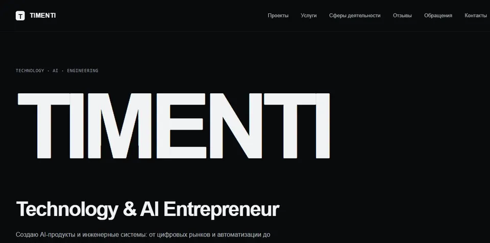
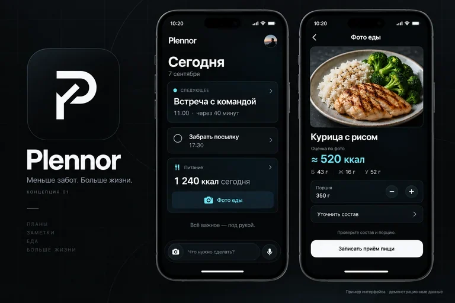
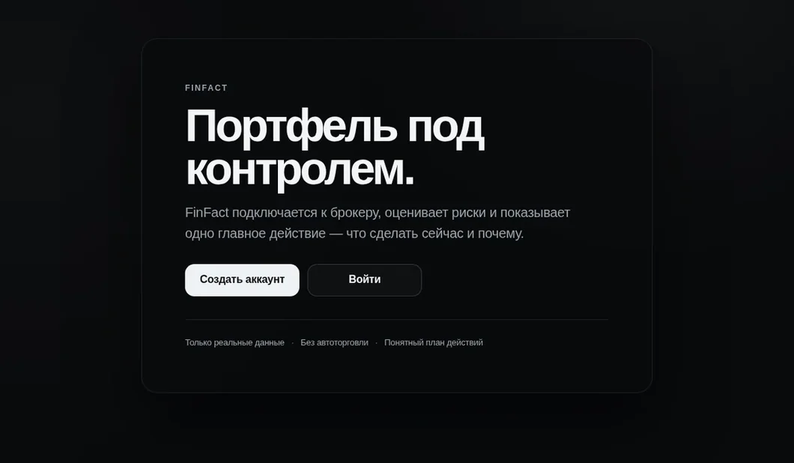
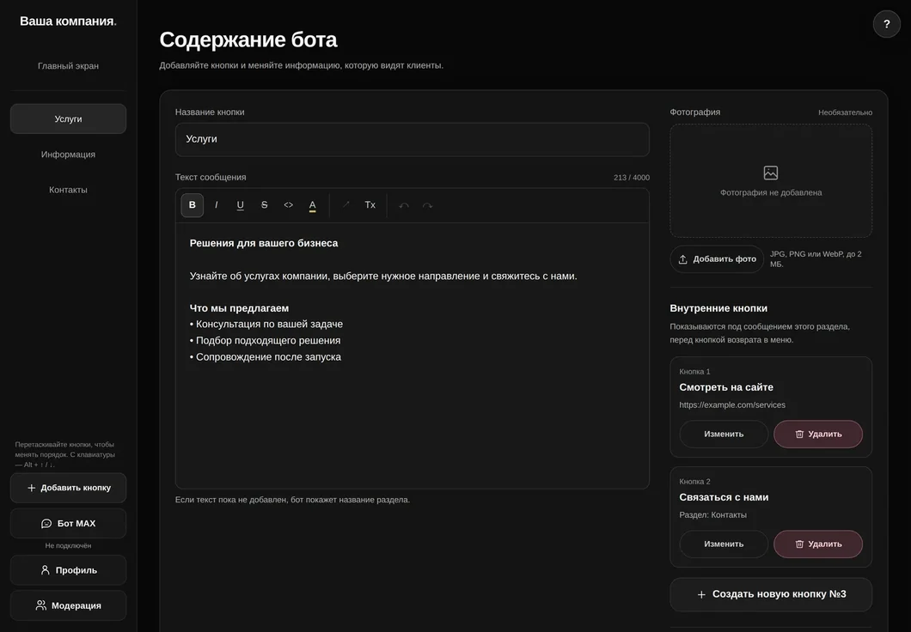
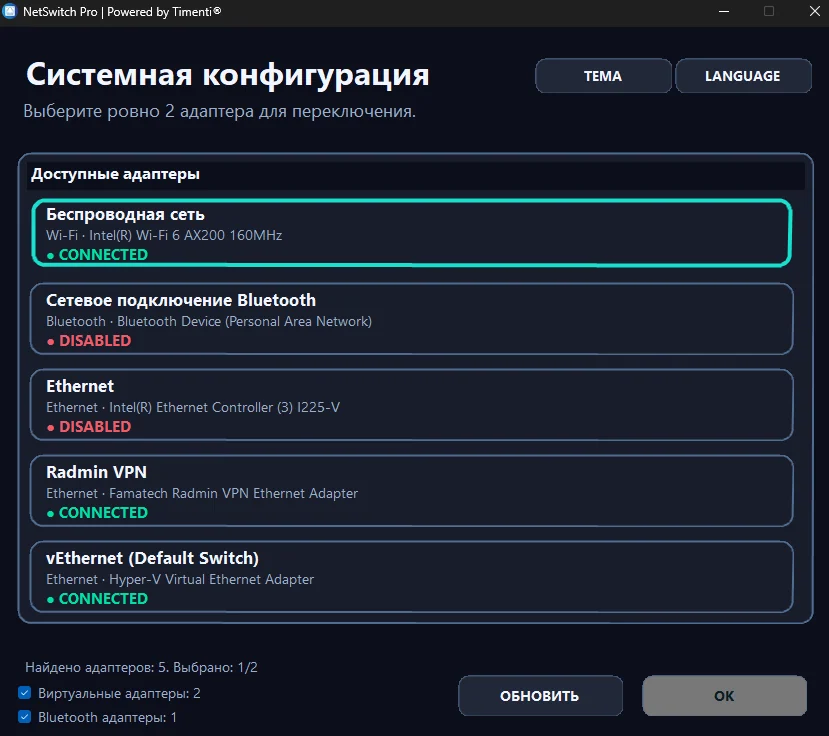
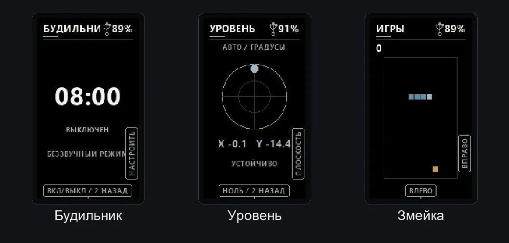

# TIMENTI

Проектирую AI-системы, приложения для Windows, веб-продукты и прошивки. Беру на себя весь цикл разработки: архитектуру, интерфейс, интеграции, испытания и выпуск. Люблю задачи, в которых программа должна работать с реальными данными, операционной системой или устройством.

[Личный сайт](https://timenti.com/) · [Каталог проектов](https://timenti.com/projects/) · [CORE](#core) · [Приложения для Windows](#windows-и-устройства) · [Связаться](https://timenti.com/contact/)

## CORE

**Персональная AI-система · исследовательская разработка**

CORE исследует, как цифровая система может сохранять непрерывную историю взаимодействия и продолжать работу между сеансами. События, решения, обязательства и незавершённые задачи становятся частью контекста, с которым система работает на компьютере, телефоне или в голосовом интерфейсе.

Цифровое воплощение и CORE Home. Концепт-кадры из публичной презентации CORE.

- **Память и история.** События связываются с людьми, проектами и решениями. У записей есть время, источник и способ уточнения.
- **Инициатива.** Система проектируется так, чтобы возвращаться к незавершённой работе и замечать важные события в заданных границах.
- **Инструменты.** Работа с файлами, задачами и устройствами требует разрешений. Для операции можно проверить, что произошло, и сверить результат с исходной целью.
- **Голос, характер и воплощение.** Разные способы общения должны опираться на одну историю и состояние. Для этого исследую локальные и облачные компоненты, голос и виртуальное пространство.

**Текущая стадия.** Архитектура и поэтапная реализация. Сценарии в презентации описывают целевую систему, а поведение каждого компонента проверяется отдельно.

[Презентация и архитектура CORE](https://timenti.com/projects/core/)

## TIMENTI.com

На своём сайте собираю проекты, технические презентации и материалы для тех, кто хочет оценить, как устроен продукт. У каждого проекта есть собственная страница со стадией разработки, демонстрацией и переходом к приложению, если оно доступно.

[Открыть timenti.com](https://timenti.com/) · [Смотреть все проекты](https://timenti.com/projects/) · [Направления работы](https://timenti.com/activity/)

## AI и веб-продукты

### VOXNORI

**Работа с аудиозаписями · Public Alpha**

После разговора VOXNORI собирает полную расшифровку, краткое содержание, решения и поручения. Из важного пункта можно вернуться к реплике и таймкоду.

Презентация интерфейса с демонстрационными данными.

<strong>Что внутри VOXNORI</strong>

- Основной сценарий проходит от загрузки записи до просмотра разбора. История хранит результаты для последующего доступа.
- Итог включает ключевые темы, решения и действия. Расшифровка позволяет сверить вывод с формулировкой участника.
- Таймкоды сохраняют связь с исходной записью. Это удобно, когда команда возвращается к задаче и уточняет, о чём договорилась.

[Презентация VOXNORI](https://timenti.com/projects/voxnori/)

### Plennor

**Личный планировщик · Public Alpha**

Plennor объединяет задачи, календарь и питание в плане на день. Повторяющиеся дела и переносы учитывают, какой экземпляр события выбран. Питание можно вести с учётом порций и КБЖУ.

Концепция интерфейса. Рабочее веб-приложение доступно в Public Alpha.

<strong>Что внутри Plennor</strong>

- Задачи, календарные события и повторы работают в общем дневном контексте. При переносе можно сверить итоговое расписание.
- Каталог продуктов хранит пищевые значения. Порцию и способ оценки можно уточнить перед добавлением.
- Веб-приложение можно установить как PWA на поддерживаемых устройствах. Через аккаунт TID доступны данные профиля и состояние продукта.

[Открыть Plennor](https://plennor.com/) · [Подробнее о продукте](https://timenti.com/projects/plennor/)

### FinFact

**Аналитика инвестиционного портфеля · опубликован**

FinFact показывает, из чего состоит портфель и какие данные лежат в основе выводов. Приложение учитывает структуру капитала, концентрацию и качество источников. Работа с брокерскими данными идёт в режиме чтения.

<strong>Что внутри FinFact</strong>

- Снимок портфеля объединяет позиции, денежные остатки и операции в доступной детализации.
- В выводе видны исходные факты, предпосылки и ограничения. При устаревших или неполных данных анализ учитывает этот пробел.
- Изменения проходят проверку сценариев на рабочем контуре перед выпуском. Управление инвестиционным портфелем и исполнение сделок остаются у владельца счёта.

Концепция экранов на основе действующего интерфейса. Демонстрационные данные.

[Открыть FinFact](https://finfacted.com/) · [Подробнее о продукте](https://timenti.com/projects/finfact/)

### A.I.S.T.

**Аналитика цифровых предметов CS2 · в разработке**

A.I.S.T. связывает особенности конкретного предмета с рынком. Проект учитывает float, pattern, историю предложений и продаж, комиссии и ликвидность, чтобы сравнивать варианты по сопоставимым критериям.

<strong>Как устроена аналитика</strong>

- Рыночные данные и характеристики предметов приводятся к единому формату. Один и тот же предмет сопоставляется между площадками.
- При оценке учитываются редкость варианта, глубина рынка и стоимость с комиссиями. Это влияет и на оценку цены, и на возможный выход из позиции.
- Целевая архитектура предусматривает проверку данных, стратегии и риска перед действиями. Публичная страница показывает концепцию и сценарии исследования.

[Презентация A.I.S.T.](https://timenti.com/projects/aist/)

### MaxBot

**Управление информационными ботами в MAX · опубликован**

MaxBot даёт организации редактор меню, текста, фотографий и вложенных кнопок. Сотрудники работают в панели, а пользователи видят опубликованное меню в MAX.

Реальный интерфейс редактора. Учебные данные.

<strong>Что внутри MaxBot</strong>

- Организация подключает своего бота, редактирует разделы и управляет составом команды.
- Для разных организаций предусмотрены отдельные кабинеты и роли. Изменение меню относится к боту выбранной организации.
- В редакторе можно работать со структурой сообщения, порядком пунктов, медиа и ссылками. Программа рассчитана на размещение на сервере организации.

[Демонстрация и описание MaxBot](https://timenti.com/projects/maxbot/)

## Windows и устройства

### ModeTapper

**Системная панель и жесты для Windows 11 · открытый проект**

ModeTapper разрабатываю прежде всего для **ASUS ROG Flow Z13 (2025, GZ302EA)**. Боковая кнопка вызывает панель или карусель. С подключённой клавиатурой работают жесты тачпада, а в планшетном режиме — свайпы с краёв сенсорного экрана.

[Сайт и демонстрации](https://timenti.github.io/ModeTapper/) · [Видео карусели](https://timenti.github.io/ModeTapper/media/carousel-motion.mp4) · [Скачать последнюю версию](https://github.com/timenti/ModeTapper/releases/latest) · [Код](https://github.com/timenti/ModeTapper)

<strong>Жесты, режимы Windows и установка</strong>

- Карусель показывает открытые окна, листает их свайпом и закрывает выбранное окно свайпом вверх. Краевые жесты также регулируют яркость, громкость и подсветку клавиатуры на совместимом оборудовании.
- Экран можно удерживать включённым постоянно или во время активной задачи Codex. Профиль производительности Windows и охлаждение ASUS переключаются независимо.
- В панели есть часы, календарь, задачи и лимиты Codex. Лупа увеличивает участок рабочего стола, а «Анимации+» меняют переходы при открытии и закрытии поддерживаемых окон.
- Камеры и маршрутизация сайтов через Happ устанавливаются как дополнительные компоненты. Установщик умеет добавлять их после первой установки и восстанавливать приложение.

[Видео открытия окна](https://timenti.github.io/ModeTapper/media/window-motion.mp4) · [Полное руководство](https://github.com/timenti/ModeTapper/blob/main/docs/FAQ.md)

### NetSwitchPro

**Портативная утилита Windows · C# и .NET 8**

NetSwitchPro переключает два выбранных сетевых адаптера одним действием и перечитывает состояние после операции. Это удобно, когда рабочее место регулярно переключается между разными подключениями.

<strong>Что внутри NetSwitchPro</strong>

- WinForms-приложение обнаруживает физические, виртуальные и Bluetooth-адаптеры через WMI.
- Состояние меняется через методы WMI. Журнал показывает шаги, результаты и ошибки операции.
- Настройки сохраняют выбранную пару, язык и тему. Приложение поставляется в одном исполняемом файле.

[Код и руководство](https://github.com/timenti/NetSwitchPro#readme)

### AirPen

**Аппаратный прототип · ESP32-S3 и Windows**

AirPen состоит из прошивки для **M5Stack StickS3 K150** и помощника для Windows. Движение устройства управляет указателем, Bluetooth передаёт команды, а помощник на компьютере отвечает за диктовку. На экране самого устройства работают отдельные утилиты.

Кадры с физического дисплея из проверки прошивки.

<strong>Прошивка, помощник и испытания</strong>

- В прошивке совместил датчик движения, Bluetooth HID, меню устройства и экранные приложения.
- Windows-помощник работает с транспортом Bluetooth и обрабатывает сценарий диктовки. Для протокола есть отдельные проверки.
- Прошивку собираю, записываю и проверяю на физическом устройстве. Автономный голосовой клиент остаётся экспериментальным направлением.

### NanoKVM Pro

**Аппаратная удалённая консоль · интеграция рабочего места**

Интегрирую готовое устройство в собственную систему обслуживания рабочих машин. Консоль даёт отдельный канал для экрана и ввода. В проверках уделяю внимание переключению источников, восстановлению связи и доступу, когда обычное удалённое рабочее место недоступно.

## Инструменты и инфраструктура

### AI_CORE

Локальный помощник и центр диагностики для Windows. В одном приложении собраны голосовые компоненты, состояние интеграций и управление разрешёнными программами. Использую его как отдельную площадку для проверки локальных сценариев и инструментов Windows.

### I

Внутренняя система долговременного контекста для разработки. Сохраняю решения, источники, статус задач и точки продолжения. Это позволяет восстанавливать ход работы по документам и проверкам, даже когда проект переходит в другой сеанс.

### TIMENTI Web и сервис обращений

Сайт объединяет портфолио, страницы продуктов, кейсы и демонстрации. Сервис обращений отдельно ведёт диалоги и отзывы. Уведомления приходят в Telegram, а у посетителя остаётся ссылка на его переписку.

[Портфолио](https://timenti.com/) · [Направления работы](https://timenti.com/activity/) · [Связаться](https://timenti.com/contact/)
