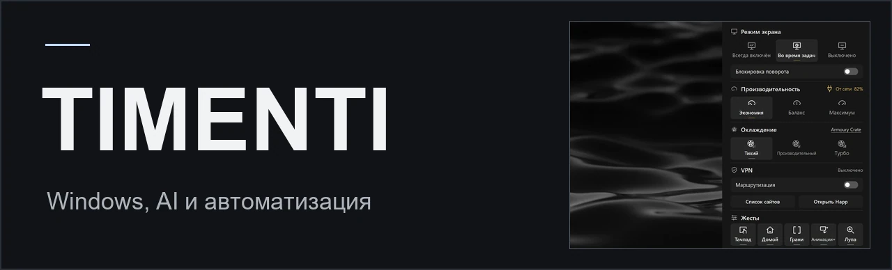

# TIMENTI

Разрабатываю утилиты для Windows, AI-продукты и системы автоматизации. Веду проекты от логики и интерфейса до сборки, установщика и публикации релиза.

[Портфолио](https://timenti.com/) · [Открытые репозитории](https://github.com/timenti?tab=repositories)

## Проекты на GitHub

### [ModeTapper](https://github.com/timenti/ModeTapper)

Карусель окон, жесты тачпада и сенсорного экрана, управление питанием и охлаждением Windows. Основная модель — ASUS ROG Flow Z13 (2025, GZ302EA).

[Демонстрации](https://timenti.github.io/ModeTapper/) · [Скачать для Windows](https://github.com/timenti/ModeTapper/releases/latest)

### [NetSwitchPro](https://github.com/timenti/NetSwitchPro)

Портативная утилита на C# и .NET 8 для переключения двух выбранных сетевых адаптеров. Показывает их состояние и ведёт журнал операций.

[Код и руководство](https://github.com/timenti/NetSwitchPro#readme)
