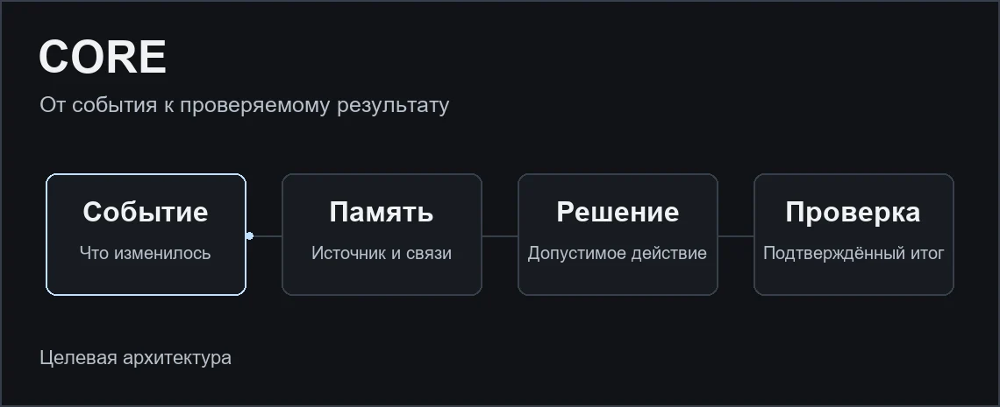
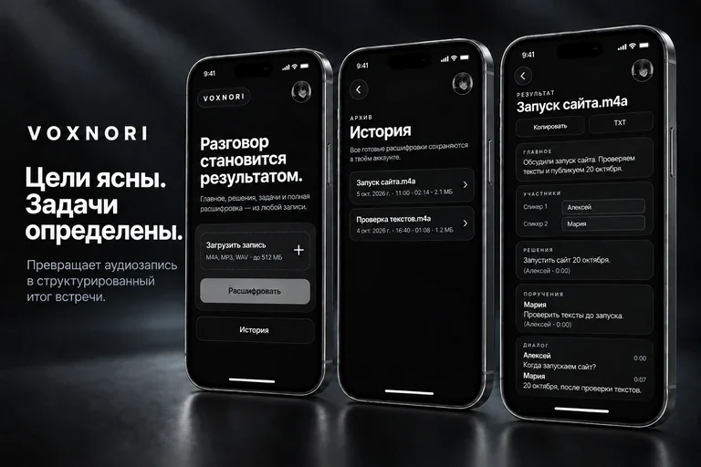
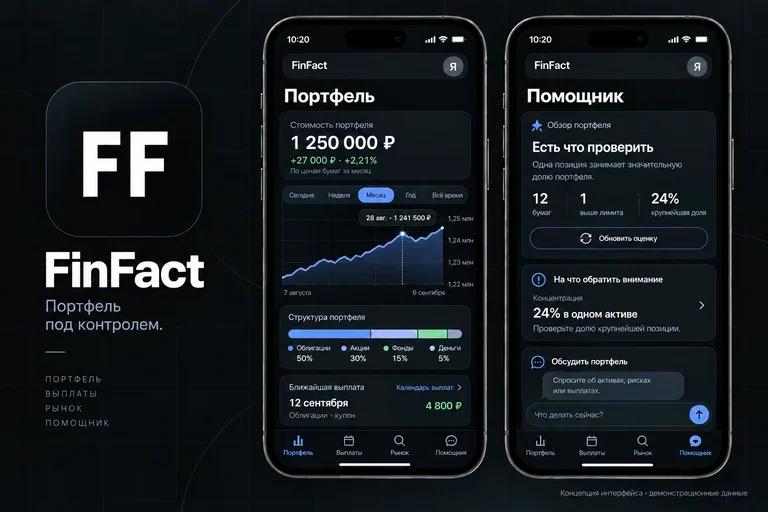
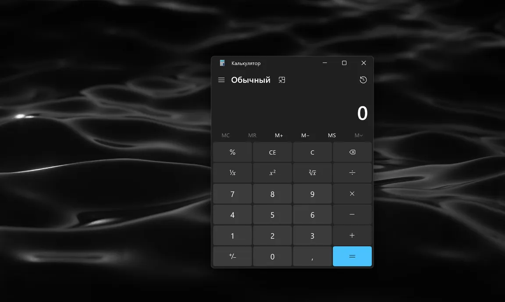
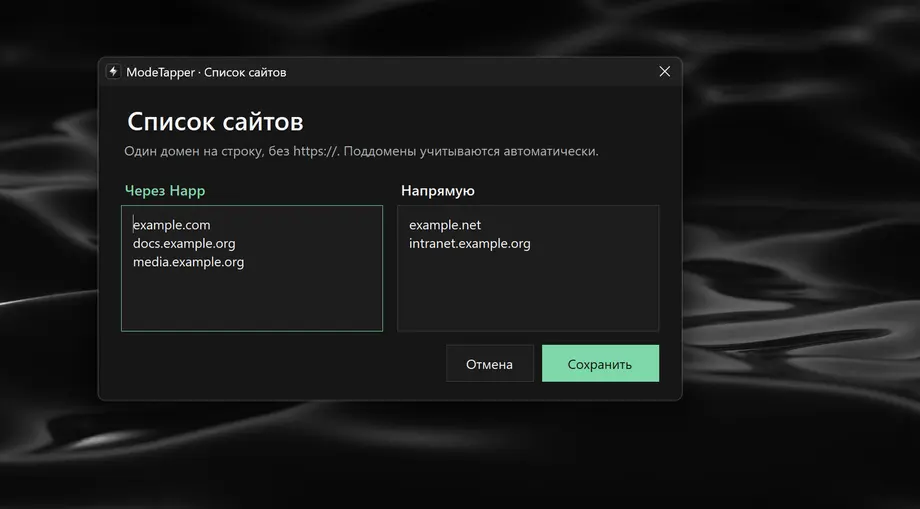
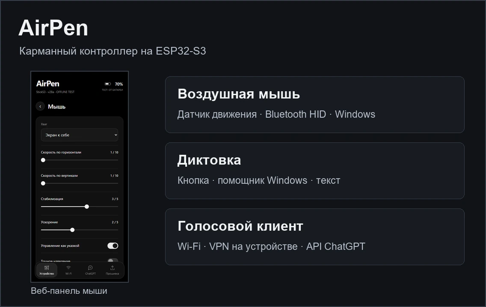
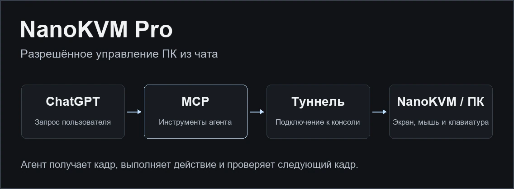
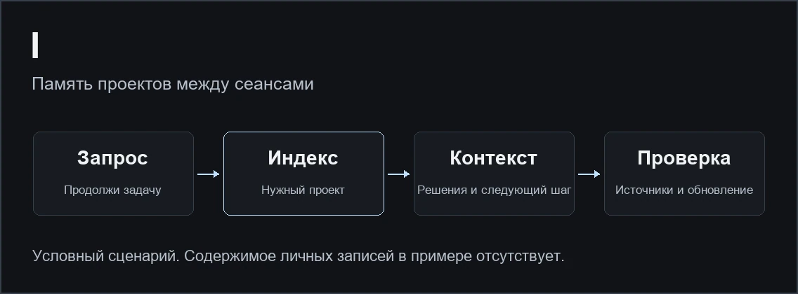

# TIMENTI

Проектирую AI-системы, приложения для Windows, веб-продукты и прошивки. Беру на себя весь цикл разработки: архитектуру, интерфейс, интеграции, испытания и выпуск. Люблю задачи, в которых программа должна работать с реальными данными, операционной системой или устройством.

[Личный сайт](https://timenti.com/) · [Каталог проектов](https://timenti.com/projects/) · [CORE](#core) · [Приложения для Windows](#windows-и-устройства) · [Связаться](https://timenti.com/contact/)

## CORE

**Персональная AI-система · исследовательская разработка**

CORE — мой главный исследовательский проект. Проектирую персональную AI-систему, которая сохраняет историю событий и решений между сеансами, удерживает состояние задач и использует этот контекст, чтобы понять, какой шаг уместен сейчас. Новое сообщение с телефона или голосовая команда связываются с той же задачей, которую начали на компьютере.

Анимированная схема целевой архитектуры.

- **Память с источниками.** Разговоры, события, файлы и решения связываются с проектами и моментом времени. Если сведения уточнились или противоречат друг другу, в истории остаётся видно, откуда взялись обе версии.
- **Рассуждение и план.** Система сопоставляет текущую цель, проверенные факты и ограничения. Для неизвестного состояния выбирает проверку, а для сложной задачи выделяет шаги и зависимости.
- **Инициатива.** Незавершённая задача, новое событие или изменившееся условие могут стать поводом вернуться к работе. Допустимость действия зависит от цели, разрешений и фактического состояния.
- **Инструменты и проверка.** Для работы с файлами, задачами и устройствами проектирую разрешённые инструменты и способ проверить итог. В памяти отражается тот результат, который удалось подтвердить.
- **Диалог в разных каналах.** Текст и голос подключаются к одной истории. Контекст задачи сохраняется при смене устройства и модели в пределах предусмотренной архитектуры.

**Пример сценария.** Пользователь просит продолжить подготовку демонстрации. CORE находит последнее подтверждённое состояние, узнаёт, какие материалы уже готовы, проверяет наличие оставшихся файлов и возвращает конкретный следующий шаг. Разрешённое действие можно выполнить и затем сверить его результат.

**Текущая стадия.** Исследую архитектуру и реализую компоненты поэтапно. Описанный сценарий показывает целевое поведение, которое предстоит проверить целиком.

[Презентация и архитектура CORE](https://timenti.com/projects/core/)

## TIMENTI.com

На своём сайте собираю проекты, технические презентации и примеры работы. На страницах продуктов объясняю, какую задачу решаю, показываю интерфейс и указываю стадию разработки. Там же находятся рабочие приложения, если они доступны, и контакты для обсуждения проектов.

В каталоге [CORE](https://timenti.com/projects/core/) представлен как исследовательская система. Страницы [Plennor](https://timenti.com/projects/plennor/) и [VOXNORI](https://timenti.com/projects/voxnori/) показывают сценарии планирования и разбора аудио. В [FinFact](https://timenti.com/projects/finfact/) можно посмотреть, как устроена аналитика портфеля, а в [MaxBot](https://timenti.com/projects/maxbot/) — как организация редактирует бота.

[Открыть timenti.com](https://timenti.com/) · [Смотреть все проекты](https://timenti.com/projects/) · [Направления работы](https://timenti.com/activity/)

## AI и веб-продукты

### VOXNORI

**Работа с аудиозаписями · Public Alpha**

После разговора VOXNORI собирает полную расшифровку, краткое содержание, решения и поручения. Из важного пункта можно вернуться к реплике и таймкоду.

Презентация интерфейса с демонстрационными данными.

<strong>Что внутри VOXNORI</strong>

- Основной сценарий проходит от загрузки записи до просмотра разбора. История хранит результаты для последующего доступа.
- Итог включает ключевые темы, решения и действия. Расшифровка позволяет сверить вывод с формулировкой участника.
- Таймкоды сохраняют связь с исходной записью. Это удобно, когда команда возвращается к задаче и уточняет, о чём договорилась.

[Презентация VOXNORI](https://timenti.com/projects/voxnori/)

### Plennor

**Личный планировщик · Public Alpha**

Plennor объединяет задачи, календарь и питание в плане на день. Повторяющиеся дела и переносы учитывают, какой экземпляр события выбран. Питание можно вести с учётом порций и КБЖУ.

Концепция интерфейса. Рабочее веб-приложение доступно в Public Alpha.

<strong>Что внутри Plennor</strong>

- Задачи, календарные события и повторы работают в общем дневном контексте. При переносе можно сверить итоговое расписание.
- Каталог продуктов хранит пищевые значения. Порцию и способ оценки можно уточнить перед добавлением.
- Веб-приложение можно установить как PWA на поддерживаемых устройствах. Через аккаунт TID доступны данные профиля и состояние продукта.

[Открыть Plennor](https://plennor.com/) · [Подробнее о продукте](https://timenti.com/projects/plennor/)

### FinFact

**Аналитика инвестиционного портфеля · опубликован**

FinFact показывает, из чего состоит портфель и какие данные лежат в основе выводов. Приложение учитывает структуру капитала, концентрацию и качество источников. Работа с брокерскими данными идёт в режиме чтения.

<strong>Что внутри FinFact</strong>

- Снимок портфеля объединяет позиции, денежные остатки и операции в доступной детализации.
- В выводе видны исходные факты, предпосылки и ограничения. При устаревших или неполных данных анализ учитывает этот пробел.
- Изменения проходят проверку сценариев на рабочем контуре перед выпуском. Управление инвестиционным портфелем и исполнение сделок остаются у владельца счёта.

Концепция экранов на основе действующего интерфейса. Демонстрационные данные.

[Открыть FinFact](https://finfacted.com/) · [Подробнее о продукте](https://timenti.com/projects/finfact/)

### MaxBot

**Управление информационными ботами в MAX · опубликован**

MaxBot даёт организации редактор меню, текста, фотографий и вложенных кнопок. Сотрудники работают в панели, а пользователи видят опубликованное меню в MAX.

Реальный интерфейс редактора. Учебные данные.

<strong>Что внутри MaxBot</strong>

- Организация подключает своего бота, редактирует разделы и управляет составом команды.
- Для разных организаций предусмотрены отдельные кабинеты и роли. Изменение меню относится к боту выбранной организации.
- В редакторе можно работать со структурой сообщения, порядком пунктов, медиа и ссылками. Программа рассчитана на размещение на сервере организации.

[Демонстрация и описание MaxBot](https://timenti.com/projects/maxbot/)

## Windows и устройства

### ModeTapper

**Системная панель и жесты для Windows 11 · открытый проект**

ModeTapper разрабатываю прежде всего для **ASUS ROG Flow Z13 (2025, GZ302EA)**. Боковая кнопка вызывает панель или карусель. С подключённой клавиатурой работают жесты тачпада, а в планшетном режиме — свайпы с краёв сенсорного экрана.

[Сайт и демонстрации](https://timenti.github.io/ModeTapper/) · [Видео карусели](https://timenti.github.io/ModeTapper/media/carousel-motion.mp4) · [Скачать последнюю версию](https://github.com/timenti/ModeTapper/releases/latest) · [Код](https://github.com/timenti/ModeTapper)

<strong>Жесты, режимы Windows и установка</strong>

- Карусель показывает открытые окна, листает их свайпом и закрывает выбранное окно свайпом вверх. Краевые жесты также регулируют яркость, громкость и подсветку клавиатуры на совместимом оборудовании.
- Экран можно удерживать включённым постоянно или во время активной задачи Codex. Профиль производительности Windows и охлаждение ASUS переключаются независимо.
- В панели есть часы, календарь, задачи и лимиты Codex. Лупа увеличивает участок рабочего стола, а «Анимации+» меняют переходы при открытии и закрытии поддерживаемых окон.
- Камеры и маршрутизация сайтов через Happ устанавливаются как дополнительные компоненты. Установщик умеет добавлять их после первой установки и восстанавливать приложение.

[Видео открытия окна](https://timenti.github.io/ModeTapper/media/window-motion.mp4) · [Полное руководство](https://github.com/timenti/ModeTapper/blob/main/docs/FAQ.md)

### NetSwitch Pro

**Windows x64 · C# и .NET 10 · переносимый EXE**

Я сделал NetSwitch Pro для сетей с разными маршрутами в интернет. Например, **Russia Network** может выходить напрямую, а **Germany Network** — через VPN на роутере. На одном экране собираю свою пару из двух Wi‑Fi-профилей, двух адаптеров или Ethernet и выбранной точки доступа. Вижу текущее подключение и переключаюсь одной кнопкой в окне либо кликом по значку в трее.

<strong>Что внутри NetSwitch Pro</strong>

- Пара из двух доступных подключений. Для беспроводного адаптера можно выбрать точный сохранённый Wi‑Fi-профиль или автоматическое подключение Windows.
- Переключение выбранной пары из главного окна и трея. В меню видно текущее подключение, обе позиции пары и сохранённые Wi‑Fi-сети.
- Управление адаптерами с проверкой готовности нового подключения и восстановлением предыдущего при сбое.
- Автозапуск в трее, системная, светлая и тёмная темы, журнал операций.

[Скачать NetSwitch Pro](https://github.com/timenti/NetSwitchPro/releases/latest) · [Смотреть демонстрацию](https://github.com/timenti/NetSwitchPro/releases/download/v2.0.9/NetSwitchPro-demo.mp4) · [Код и руководство](https://github.com/timenti/NetSwitchPro#readme)

### AirPen

**Аппаратный прототип · ESP32-S3 и Windows**

AirPen — карманный контроллер на **M5Stack StickS3 K150**. Им можно двигать курсор и нажимать кнопки с расстояния по Bluetooth. В Windows есть помощник для диктовки, а на самом контроллере — сетевой голосовой режим ChatGPT.

Слева — реальный кадр веб-панели при тестировании. Справа — схема функций.

<strong>Прошивка, помощник и испытания</strong>

- **Воздушная мышь.** Движение руки считывает датчик, а контроллер передаёт перемещение и клики в Windows как Bluetooth HID. В веб-панели настраиваю скорость по осям, стабилизацию, ускорение и хват.
- **Диктовка.** Кнопка контроллера запускает сценарий в помощнике Windows. Распознанный текст можно вводить в активное приложение. Режимы кнопки и Bluetooth-протокол проверяю отдельно.
- **Связь с API ChatGPT.** На устройстве предусмотрены Wi-Fi, VPN-клиент и свой раздел голосового общения. В автономном сценарии контроллер подключается к API и используется как голосовой интерфейс для агента.
- **Проверка на железе.** Прошивку собираю и прошиваю на физический контроллер. Сетевые сценарии и голосовой клиент проходят отдельные испытания.

### NanoKVM Pro

**Аппаратная удалённая консоль · собственный MCP-сервер и туннель**

Подключил **NanoKVM Pro** к компьютеру, настроил туннель и создал MCP-сервер с инструментами управления. В чате ChatGPT с подключённым сервером агент может получить кадр с ПК, выполнить разрешённое действие мышью или клавиатурой и запросить новый кадр, чтобы проверить результат.

- **Экран и ввод.** Снимки рабочего стола, движение мыши, клики, прокрутка, сочетания клавиш и ввод текста.
- **Диагностика и работа с Windows.** Проверка состояния консоли, просмотр окон и работа с разрешёнными командами на собственном компьютере.
- **Обслуживание.** Обмен файлами, проверка и подключение ISO-образов и управление питанием в сконфигурированных сценариях.
- **Контроль результата.** Сначала посмотреть состояние, затем выполнить согласованное действие и сверить результат по кадру или ответу инструмента.

[Платформа NanoKVM Pro](https://github.com/sipeed/NanoKVM-Pro)

## Инструменты и инфраструктура

### I

**Переносимая память для проектов и AI-ассистентов**

I сохраняет контекст работы между сеансами. Когда новый чат получает задачу, он может найти нужный проект, прочитать последнее подтверждённое состояние и понять, где продолжить. Это помогает переносить работу между средами, сохраняя связь с исходными решениями, коммитами и проверками.

1. **Найти нужное.** По индексу выбираются проект и его краткая сводка для продолжения работы. Читаются только записи по задаче.
2. **Восстановить ход работы.** Решения, результаты и ограничения хранятся с датой и источником. Сводка объясняет, что уже сделано, где искать доказательства и какой следующий шаг открыт.
3. **Перепроверить.** Сведения сверяются с живым состоянием репозитория, файлами или результатами проверки. Подтверждение, предположение и спорная запись различаются.
4. **Добавить новый результат.** После работы в память записывается проверенное изменение. При уточнении старого решения сохраняется связь с предыдущей версией.

Записи имеют стабильные идентификаторы. Для чтения используются проектные сводки, для локального поиска есть индекс, а перенос между средами опирается на Git. Исходные переписки хранятся локально.

### TIMENTI Web и сервис обращений

Сайт объединяет портфолио, страницы продуктов, кейсы и демонстрации. Сервис обращений отдельно ведёт диалоги и отзывы. Уведомления приходят в Telegram, а у посетителя остаётся ссылка на его переписку.

[Портфолио](https://timenti.com/) · [Направления работы](https://timenti.com/activity/) · [Связаться](https://timenti.com/contact/)
